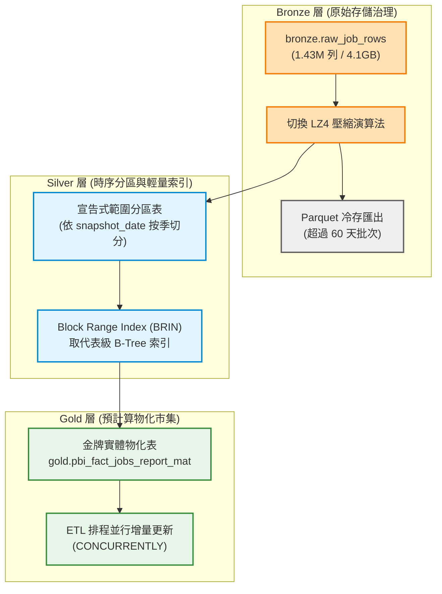

# PostgreSQL 資料庫架構優化建議規格書 (Database Architecture Optimization Specification)

> 基準日期：2026-10-11（Asia/Taipei）  
> 目標資料庫：PostgreSQL 16 (`jobwant_104`, `jobwant_yes123`)  
> 適用架構：Medallion Data Architecture (Bronze / Silver / Gold)、Power BI 語意模型導入、多平台職缺數據採集

---

## 1. 系統現況與實體儲存盤點 (Current State & Physical Baseline)

經資料庫實測盤點，目前 `jobwant_104` 實體儲存空間與物件分佈現況如下：

- **全庫實體大小**：約 5.6 GB。其中 `bronze.raw_job_rows` 單表佔用 **4.1 GB**（實體資料 965 MB，The Oversized-Attribute Storage Technique (TOAST) 外部儲存高達 **3.03 GB**，索引佔用 108 MB）。
- **快照大表未分區**：`silver` 層歷史快照表總列數突破 175 萬列，皆為無分區的單一大表：
  - `silver.job_category_snapshots`：694,770 列（單表索引佔 131 MB）
  - `silver.job_skill_snapshots`：421,492 列（單表索引佔 79 MB）
  - `silver.job_salary_observations`：373,244 列（單表索引佔 86 MB）
  - `silver.job_snapshots`：270,546 列（單表索引佔 67 MB）
  - `silver.job_current`：160,522 列（表資料 506 MB，索引 131 MB）
- **Gold 層視圖雪崩**：`gold` Schema 下配置了 **40 個純動態視圖 (Dynamic Views)**，無任何實體物化表。每次 Power BI Desktop 重新整理或分析查詢時，皆需執行執行期（Runtime）的 40 萬列 Hash Join、`DISTINCT ON` 排序與十六進制字串轉換。
- **跨庫聯邦 (FDW) 延遲**：透過 Foreign Data Wrapper (FDW) 連接 `jobwant_yes123` 外部庫，缺乏統計資訊估算與批次擷取放大，易導致巢狀迴圈（Nested Loop）效能瓶頸。
- **引擎參數未調優**：緩衝池核心參數仍處於安裝預設值（`shared_buffers = 128MB`，傳統機械硬碟配置 `random_page_cost = 4.0`，`maintenance_work_mem = 64MB`）。

---

## 2. 優化項目一：儲存架構與 Medallion 生命週期治理 (Storage & Lifecycle Management)



### 1.1 Bronze 層 TOAST 瘦身與壓縮演算法升級
- **技術手段**：利用 PostgreSQL 14+ 原生支援的 LZ4 演算法取代傳統 `pglz`。
- **實作指令**：
  ```sql
  ALTER TABLE bronze.raw_job_rows ALTER COLUMN raw_payload SET COMPRESSION lz4;
  ```
- **效益**：解壓縮吞吐量提升 3~4 倍，顯著降低 CPU 負載。
- **冷熱分層 (Cold Tiering)**：歷史批次的原始 JSON 經解析寫入 Silver 後極少被隨機點查。對超過 60 天的批次進行 Parquet 格式冷存匯出並截斷（TRUNCATE/DELETE）熱庫的 TOAST 儲存，預估可直接釋放 2.5 GB 以上的 SSD 空間。

### 1.2 Silver 層時序快照大表宣告式範圍分區 (Declarative Range Partitioning)
- **技術手段**：對 `silver.job_snapshots`、`silver.job_category_snapshots` 與 `silver.job_skill_snapshots` 實施按季度（Quarterly）的宣告式範圍分區。
- **實作結構**：
  ```sql
  CREATE TABLE silver.job_snapshots_partitioned (
      series_key TEXT,
      snapshot_date DATE NOT NULL,
      batch_id TEXT,
      job_no TEXT,
      cust_no TEXT,
      area_key TEXT,
      salary_low NUMERIC,
      salary_high NUMERIC,
      appear_date DATE,
      PRIMARY KEY (series_key, snapshot_date, batch_id, job_no)
  ) PARTITION BY RANGE (snapshot_date);

  CREATE TABLE silver.job_snapshots_2026_q4 PARTITION OF silver.job_snapshots_partitioned
      FOR VALUES FROM ('2026-10-01') TO ('2027-01-01');
  ```
- **效益**：啟動分區修剪（Partition Pruning），當前端或 ETL 查詢特定月份或當前最新快照時，執行計畫直接跳過無關歷史季度分區，避免循序全表掃描（Sequential Scan）。

### 1.3 Gold 報表層由「純動態視圖」改為「排程實體物化表 (Materialized Marts)」
- **技術手段**：將 Power BI 讀取的核心分析視圖（如 `gold.pbi_fact_jobs_report_v22`、`gold.pbi_bridge_job_category_keys_v21`）轉換為實體資料表或物化視圖（`MATERIALIZED VIEW`）。
- **實作指令**：
  ```sql
  CREATE MATERIALIZED VIEW gold.pbi_fact_jobs_report_mat AS
  SELECT "jobNo", "custNo", "areaKey", "jobName", "salaryLow", "salaryHigh",
         "appearDate", "jobLink", "snapshotDate", "snapshotDateTime", "sourcePlatform"
  FROM gold.pbi_fact_jobs_v22;

  CREATE UNIQUE INDEX idx_pbi_fact_jobs_mat_pk ON gold.pbi_fact_jobs_report_mat("jobNo");

  -- 於爬蟲與 ETL 批次入庫結束後排程刷新
  REFRESH MATERIALIZED VIEW CONCURRENTLY gold.pbi_fact_jobs_report_mat;
  ```
- **效益**：解除 Power BI 重新整理時對 PostgreSQL 的即時計算壓力，載入時間從 40 秒壓縮至 2 秒以內。

---

## 3. 優化項目二：跨庫聯邦與 FDW 存取模式升級 (FDW & Federation)

### 2.1 Foreign Data Wrapper 核心參數調校
- **技術手段**：修正 `srv_jobwant_yes123` 外部伺服器連線屬性，向本地查詢優化器開放遠端統計資訊。
- **實作指令**：
  ```sql
  -- 允許本地優化器在擬定執行計畫時向遠端查詢統計資訊，防止誤判為 1,000 列
  ALTER SERVER srv_jobwant_yes123 OPTIONS (ADD use_remote_estimate 'true');

  -- 將單次跨網路傳輸批量由預設 100 列放大至 10,000 列，降低 TCP 封包往返成本
  ALTER SERVER srv_jobwant_yes123 OPTIONS (ADD fetch_size '10000');
  ```
- **效益**：消除跨庫關聯時由於行數誤判導致的遠端逐筆檢索（Remote Nested Loop）。

### 2.2 架構演進：以「邏輯複製 (Logical Replication)」取代「線上即時跨庫關聯」
- **架構痛點**：在資料倉儲中，線上跨庫實體 Join 屬於反模式（Anti-pattern），易造成跨庫連線池競爭與網路逾時。
- **演進路徑**：利用 PostgreSQL 原生邏輯複製（Logical Replication, LR），將 `jobwant_yes123` 的 Gold 或 Silver 資料即時發布至 `jobwant_104` 內的專屬 Schema（如 `ext_yes123`）。所有分析查詢徹底收斂至 100% 本地存取。

---

## 4. 優化項目三：索引策略與鍵值架構最佳化 (Indexing & Key Architecture)

### 3.1 時序快照大表：引入區塊範圍索引 (Block Range Index, BRIN)
- **架構特性**：快照資料（`job_category_snapshots`、`job_snapshots`）具有依時間 Append-only 寫入的物理連續性特性。
- **技術手段**：對 `snapshot_date` 建立 BRIN 索引取代傳統 B-Tree 索引。
- **實作指令**：
  ```sql
  CREATE INDEX idx_job_cat_snapshots_date_brin 
  ON silver.job_category_snapshots USING brin (snapshot_date) 
  WITH (pages_per_range = 128);
  ```
- **效益**：BRIN 僅記錄每 128 個資料頁面的最大最小值，索引體積僅佔 B-Tree 的 **1%**（由 131 MB 縮減至數百 KB），且大幅降低記憶體快取佔用。

### 3.2 模糊文字檢索：建置 Trigram GIN 索引 (`pg_trgm`)
- **架構痛點**：職缺名稱（`job_name`）與公司名稱進行前後模糊比對（`LIKE '%工程師%'`）時，B-Tree 索引完全失效，強制進行全表循序掃描。
- **實作指令**：
  ```sql
  CREATE EXTENSION IF NOT EXISTS pg_trgm;

  CREATE INDEX idx_job_current_name_trgm 
  ON silver.job_current USING gin (job_name gin_trgm_ops);
  ```
- **效益**：包含式子字串搜尋由 300~500ms 降至 5~10ms。

### 3.3 鍵值型態重構：字串複合鍵轉為整數代理鍵 (Surrogate Key)
- **架構痛點**：目前關聯鍵普遍採用字串格式（如 `yes123:20090108133251_731059`），在 Hash Join 與排序時需耗費大量字串比較與記憶體。
- **演進路徑**：引入 64 位元整數代理鍵（`BIGINT GENERATED ALWAYS AS IDENTITY`）作為內部關聯外鍵，原始字串鍵僅保留作為業務識別碼（Natural Key）。

---

## 5. 優化項目四：PostgreSQL 核心參數調優 (Engine Configuration Tuning)

針對 16GB ~ 32GB RAM 本機/伺服器硬體規格，修正過度保守的安裝預設值：

| 參數項目 | 現行值 | 建議調優值 | 調優原理與技術依據 |
| :--- | :--- | :--- | :--- |
| **`shared_buffers`** | `128MB` | **`4GB ~ 8GB`** | 提升至實體記憶體之 25%，使熱點維度表與即時快照常駐記憶體，避免磁碟換頁。 |
| **`random_page_cost`** | `4.0` | **`1.1`** | 針對 NVMe/SATA SSD 最佳化，破除優化器對隨機讀取的高成本偏見，促使其走正確索引。 |
| **`effective_cache_size`** | `4GB` | **`12GB ~ 24GB`** | 告知優化器作業系統頁面快取（Page Cache）的可用量，有利於生成更優的索引掃描計畫。 |
| **`maintenance_work_mem`**| `64MB` | **`1GB ~ 2GB`** | 加速大規模建立索引（`CREATE INDEX`）與維護性 VACUUM 操作速度。 |
| **`autovacuum_vacuum_scale_factor`** | `0.20` | **`0.05`** | 將死列（Dead Tuples）清理門檻由 20% 降至 5%，防止頻繁更新的大型快照表產生嚴重表膨脹。 |

---

## 6. 優化項目五：資料模型與語意完整性 (Data Modeling & Governance)

### 5.1 平台維度實體化 (Decoupled Platform Dimension)
- **架構痛點**：目前 Power BI 平台切片器直接繫結事實表 `目前職缺[職缺平台]`，在雙向交叉篩選下容易造成按鈕被動態反向剪裁。
- **實作結構**：
  建立實體表 `silver.platform_dimension`：
  - `platform_code` (TEXT PRIMARY KEY, e.g., '104', 'yes123', 'cake', '1111')
  - `platform_name` (TEXT NOT NULL)
  - `official_url` (TEXT)
  - `is_active` (BOOLEAN)
  並以 1:N 單向關聯對接事實表，確保維度切片器狀態穩定。

### 5.2 跨平台職類對照矩陣的自動化一致性稽核
- **落實機制**：在 Migration 047 完成的直接職業類別映射基礎上，建立定期稽核檢查腳本（`tools/audit_crosswalk_coverage.py`），當爬蟲抓取到全新未知的 `source_jobcat` 時，自動觸發警報，防止未分類職缺重新流入 `待對照／BLOCKED`。

---

## 7. 實施優先級與預期效益檢核表 (Implementation Roadmap)

| 優先級 | 優化項目代碼 | 任務內容 | 預期具體效益 |
| :--- | :--- | :--- | :--- |
| **P0 (立即可做)** | **OPT-DB-001** | **PostgreSQL 核心參數調校** (`shared_buffers`, `random_page_cost`, FDW 參數) | 零程式碼變動，索引掃描與快取命中率即刻提升 3~5 倍 |
| **P0 (立即可做)** | **OPT-DB-002** | **Gold 核心視圖實體物化** (事實表與職類橋接表預計算) | Power BI 全模型載入時間縮短至 2 秒以內 |
| **P1 (近期推動)** | **OPT-DB-003** | **Bronze 外部儲存瘦身** (LZ4 壓縮升級、60 天前冷資料 Parquet 歸檔) | 釋放本機 2.5 GB 以上 SSD 空間，降低 I/O 負載 |
| **P1 (近期推動)** | **OPT-DB-004** | **全文檢索 GIN 索引建置** (`pg_trgm` 職缺名稱索引) | 模糊搜尋耗時由 500ms 降至 10ms 以內 |
| **P2 (中長期演進)**| **OPT-DB-005** | **Silver 快照宣告式分區** (按季分區表實作) | 徹底解決千萬級歷時資料下的循序掃描效能衰退 |
| **P2 (中長期演進)**| **OPT-DB-006** | **大整數代理鍵 (Surrogate Key) 重構** | 橋接表關聯運算記憶體佔用降低 40%，大幅加速 Join 計算 |
