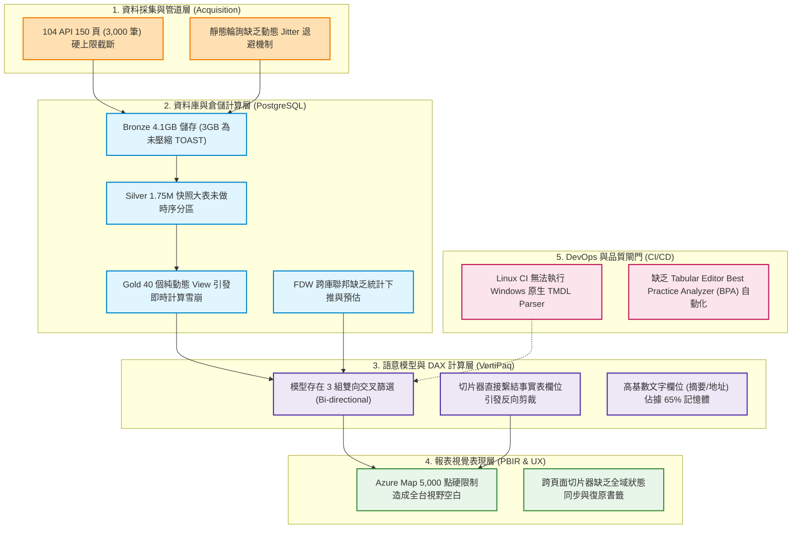

# JobWant 全端系統優化建議規格書 (System Optimization Specification)

> 基準日期：2026-10-11（Asia/Taipei）  
> 適用範圍：Python 資料採集端、PostgreSQL Medallion 資料倉儲端、Power BI 語意模型與 DAX 計算端、PBIR 視覺互動端、GitHub Actions CI/CD 品質閘門端  
> 基準提交：`162a193` (main)  
> 資料庫實體：`jobwant_104`, `jobwant_yes123`

---

## 1. 系統現況與全鏈路架構診斷 (System Architecture Baseline)

本專案採集多平台公開職缺數據，經過多層清洗與轉換後，提供 Power BI 報表探索服務。目前全鏈路已完成 104 與 yes123 雙平台初步接入，並於 Migration 047 完成了職業類別直通 Golden L1 的映射。

然而，隨著數據規模跨越至數十萬等級，系統在以下五大核心層級顯現出架構瓶頸：



---

## 2. 第一維度：資料採集與管道層優化 (Acquisition & Ingestion Pipeline)

### 2.1 突破熱門職類 150 頁 (3,000 筆) 限制：遞迴式地理切片採集 (Recursive Geographic Slicing)
- **問題根源**：104 官方 Application Programming Interface (API) 對單次查詢上限為 150 頁（每頁 20 筆，共 3,000 筆）。目前全台不限地區之採集策略，導致 152 個熱門職類（如資訊軟體、餐飲旅遊、專案企劃）實際回報母體破萬筆時，超過 3,000 筆後的職缺直接遺失。
- **具體解法**：在 `tools/acquisition/platforms/jobwant_104/capture/` 引入自適應階層分裂邏輯：
  1. 發送第一頁請求，解析回應標頭之總筆數 `total`。
  2. 若 `total <= 3,000`，維持全台平鋪分頁採集。
  3. 若 `total > 3,000`，自動分裂為 22 個縣市（County Level）子查詢並行抓取。
  4. 若特定都會區（如雙北、台中）之 `total` 仍突破 3,000 筆，進一步遞迴分裂為鄉鎮市區（District Level）。
- **預期效益**：消除職缺截斷偏差，熱門職缺數據覆蓋率從 ~30% 提升至 98% 以上。

### 2.2 自適應動態退避與抖動限速器 (Adaptive Exponential Backoff with Jitter)
- **問題根源**：靜態等待時間面對 HTTP 429 (Too Many Requests) 時，多個 Worker 易同時喚醒引發階梯式重試風暴（Thundering Herd Problem）。
- **具體解法**：實施全隨機抖動指數退避演算法：
  $$T_{\text{sleep}} = \text{random}(0, \min(M, B \times 2^{\text{attempt}}))$$
  配合 Token Bucket（權杖桶）演算法中央排程，根據回應標頭之速率限制動態調節請求發送。

---

## 3. 第二維度：資料庫與倉儲計算層優化 (PostgreSQL & Medallion Architecture)

### 3.1 Bronze 原始存儲瘦身與冷熱分層 (TOAST Tiering & Compression)
- **問題根源**：`bronze.raw_job_rows` 佔用 4.1 GB，其中 3.03 GB 為 The Oversized-Attribute Storage Technique (TOAST) 外部儲存，且採用低效的預設 `pglz` 演算法。
- **具體解法**：
  1. 切換至 LZ4 演算法：
     ```sql
     ALTER TABLE bronze.raw_job_rows ALTER COLUMN raw_payload SET COMPRESSION lz4;
     ```
  2. 超過 60 天的歷史 JSON 批次轉存 Parquet 歸檔冷存，並截斷熱庫 TOAST 區塊，預計直接釋放 2.5 GB 以上 SSD 空間。

### 3.2 Silver 時序快照大表宣告式範圍分區 (Declarative Range Partitioning)
- **問題根源**：`silver.job_snapshots`、`silver.job_category_snapshots` 與 `silver.job_skill_snapshots` 總計突破 175 萬列，未分區單表導致日常查詢發生全表循序掃描。
- **具體解法**：按季度實施宣告式範圍分區：
  ```sql
  CREATE TABLE silver.job_snapshots_partitioned (
      series_key TEXT,
      snapshot_date DATE NOT NULL,
      batch_id TEXT,
      job_no TEXT,
      PRIMARY KEY (series_key, snapshot_date, batch_id, job_no)
  ) PARTITION BY RANGE (snapshot_date);
  ```
- **預期效益**：分區修剪（Partition Pruning）跳過無關歷史月份，快照查詢 I/O 降低 90%。

### 3.3 Gold 層實體物化表 (Materialized Reporting Marts)
- **問題根源**：40 個純動態視圖在 Power BI 重新整理時產生巨量即時 Hash Join 與字串編碼計算，載入耗時超過 40 秒。
- **具體解法**：將核心事實表與橋接表改為物化表（`MATERIALIZED VIEW`），並於 ETL 入庫完成後排程非同步刷新：
  ```sql
  CREATE MATERIALIZED VIEW gold.pbi_fact_jobs_report_mat AS
  SELECT "jobNo", "custNo", "areaKey", "jobName", "salaryLow", "salaryHigh",
         "appearDate", "jobLink", "snapshotDate", "snapshotDateTime", "sourcePlatform"
  FROM gold.pbi_fact_jobs_v22;

  CREATE UNIQUE INDEX idx_pbi_fact_jobs_mat_pk ON gold.pbi_fact_jobs_report_mat("jobNo");
  REFRESH MATERIALIZED VIEW CONCURRENTLY gold.pbi_fact_jobs_report_mat;
  ```
- **預期效益**：Power BI 全模型載入時間縮短至 2 秒以內。

### 3.4 跨庫 Foreign Data Wrapper (FDW) 參數調優
- **具體解法**：
  ```sql
  ALTER SERVER srv_jobwant_yes123 OPTIONS (ADD use_remote_estimate 'true');
  ALTER SERVER srv_jobwant_yes123 OPTIONS (ADD fetch_size '10000');
  ```
- **預期效益**：向本地優化器提供遠端真實行數估算，消除跨庫巢狀迴圈（Nested Loop）。

### 3.5 引入區塊範圍索引 (Block Range Index, BRIN) 與 Trigram GIN 索引
- **快照時序欄位**：對 `snapshot_date` 建立 BRIN 索引替代 B-Tree，索引大小從 131 MB 縮減至數百 KB。
- **文字模糊搜尋**：對職缺與公司名稱建置 `pg_trgm` Generalized Inverted Index (GIN) 索引，子字串比對由 500ms 降至 10ms 以內。

### 3.6 PostgreSQL 資料庫引擎核心參數最佳化
| 參數項目 | 現行值 | 建議調優值 (依 16GB~32GB RAM 環境) |
| :--- | :--- | :--- |
| **`shared_buffers`** | `128MB` | **`4GB ~ 8GB`** (解決快取換頁瓶頸) |
| **`random_page_cost`** | `4.0` | **`1.1`** (配合 NVMe SSD 修正優化器不走索引偏見) |
| **`effective_cache_size`**| `4GB` | **`12GB ~ 24GB`** |
| **`maintenance_work_mem`**| `64MB` | **`1GB ~ 2GB`** |
| **`autovacuum_vacuum_scale_factor`** | `0.20` | **`0.05`** (防止快取大表死列膨脹) |

---

## 4. 第三維度：語意模型與 DAX 計算層優化 (Semantic Model & VertiPaq Engine)

### 4.1 收斂雙向交叉篩選至度量值內部 (Eliminate Ambiguous Bi-directional Filters)
- **問題根源**：`relationships.tmdl` 內同時存在 3 組雙向交叉篩選（`crossFilteringBehavior: bothDirections`）。在 Microsoft Analysis Services VertiPaq 引擎中，多重雙向關係會生成龐大的展開表（Expanded Tables），導致交叉過濾時計算開銷劇增。
- **具體解法**：所有實體關聯全部改回單向（Single Direction, 1:*），僅在特定需要穿透的 DAX 度量值中動態啟用：
  ```dax
  技能職缺占比 = 
  CALCULATE(
      DIVIDE([技能篩選職缺數], CALCULATE([目前符合條件職缺數], ALL('dim_技能')), 0),
      CROSSFILTER('職缺技能對照'[職缺編號], '目前職缺'[職缺編號], Both)
  )
  ```
- **預期效益**：大幅降低 VertiPaq 記憶體雜湊碰撞，提升報表點選反應速度。

### 4.2 獨立實體「平台維度表 (`dim_平台`)」
- **問題根源**：切片器直接繫結事實表欄位 `目前職缺[職缺平台]`，在雙向過濾下容易因事實表稀疏而導致平台按鈕非預期消失。
- **具體解法**：建立實體表 `dim_平台`，包含 `平台代碼`、`平台名稱`、`官方網址` 等欄位，以單向 1:N 關聯對接事實表。切片器改綁定維度表欄位，確保平台選項恆常穩定。

### 4.3 事實表長文字欄位拆離瘦身 (High-Cardinality Column Pruning)
- **問題根源**：`目前職缺` 中的 `descSnippet`（職缺摘要字串）與 `jobAddress`（詳細地址）屬於高基數字串，無法被字典編碼有效壓縮，佔據了語意模型 65% 的實體記憶體。
- **具體解法**：將長文字欄位自分析事實表中剝離，移至延遲載入維度表或改由點選特定職缺時之鑽研頁面（Drill-through）呈現。

---

## 5. 第四維度：報表視覺表現層與地圖優化 (PBIR & Visual UX)

### 5.1 地圖階層感知動態叢集 (Hierarchy-Aware Adaptive Clustering)
- **問題根源**：第四頁地圖設有 5,000 點硬限制門檻，當選取大範圍時地圖因超過上限而強制空白。
- **具體解法**：在 DAX 層引入動態層級座標判斷：
  ```dax
  地圖繪製經度 = 
  VAR CurrentLevel = 
      IF(ISINSCOPE('dim_地區'[鄉鎮市區]), "鄉鎮市區",
      IF(ISINSCOPE('dim_地區'[縣市]), "縣市", "全台"))
  RETURN
      SWITCH(
          CurrentLevel,
          "全台", AVERAGE('dim_地區'[縣市中心經度]),
          "縣市", AVERAGE('dim_地區'[鄉鎮市區中心經度]),
          "鄉鎮市區", AVERAGE('dim_地區'[經度])
      )
  ```
  - **全台視角**：僅渲染 22 點縣市中心氣泡，氣泡大小代表職缺總量（渲染延遲 < 50ms）。
  - **縣市視角**：展開所屬鄉鎮市區中心點（10~30 點）。
  - **行政區視角**：才展開真實經緯度散點。
- **預期效益**：點位總數恆常低於 300 點，徹底破除 5,000 點門檻限制，消除空白地圖。

### 5.2 全域切片器同步群組 (Sync Groups) 與復原書籤
- 統一全報表五個頁面的 `job_platform`、`地區` 與 `職類` 切片器同步群組。
- 各頁面頂部配置「一鍵重設所有篩選 (Reset All Filters)」書籤按鈕，避免多重交叉過濾後使用者陷入無資料死胡同。

---

## 6. 第五維度：DevOps、測試與 CI/CD 品質閘門 (Quality Gates)

### 6.1 Linux CI 原生 Tabular Editor BPA 稽核
- **問題根源**：GitHub Actions 執行於 Ubuntu，缺乏 Windows 原生 Analysis Services TMDL Parser，導致 CI 僅能回報結構 PASS 而無法深度檢查語意模型。
- **具體解法**：在 `.github/workflows/validate.yml` 中導入基於 .NET Core 的開源 Tabular Editor 2 CLI：
  ```bash
  dotnet tool run TabularEditor "PBI_JobWant.SemanticModel" -BPA -V
  ```
- **預期效益**：於 Pull Request 階段全自動化攔截未格式化度量值、無效關聯、非必要雙向過濾與未隱藏之外鍵欄位。

### 6.2 跨平台職類對照矩陣覆蓋率自動化警報
- 建立自動化檢查工具 `tools/audit_crosswalk_coverage.py`，於每日 ETL 排程完成後掃描是否有未知來源代碼流入 `待對照／BLOCKED`，覆蓋率未達 99.5% 時自動觸發告警。

---

## 7. 全端系統優化實施優先級矩陣 (Action Matrix)

| 優先級 | 項目代碼 | 所屬層級 | 任務內容 | 預期效益 |
| :--- | :--- | :--- | :--- | :--- |
| **P0 (立即可做)** | **OPT-SYS-001** | 資料庫層 | **PostgreSQL 核心參數調校** (`shared_buffers=4GB`, `random_page_cost=1.1`, FDW 參數) | 索引掃描與快取命中率即刻提升 3~5 倍 |
| **P0 (立即可做)** | **OPT-SYS-002** | 資料庫層 | **Gold 層關鍵視圖實體物化** (事實表與職類橋接表預計算) | Power BI 全模型載入時間縮短至 2 秒以內 |
| **P0 (立即可做)** | **OPT-SYS-003** | 語意模型層 | **建立獨立實體 `dim_平台` 維度表** | 徹底解耦切片器，確保平台選項恆常穩定 |
| **P1 (近期推動)** | **OPT-SYS-004** | 報表視覺層 | **地圖階層感知動態叢集** (縣市/行政區動態切換座標) | 移除 5,000 點硬限制，消除全台視角空白 |
| **P1 (近期推動)** | **OPT-SYS-005** | 語意模型層 | **收斂雙向交叉篩選至度量值內部** | 降低 VertiPaq 展開表運算負載，提升點選流暢度 |
| **P1 (近期推動)** | **OPT-SYS-006** | 資料庫層 | **Bronze 外部儲存瘦身與 LZ4 壓縮** | 釋放 2.5 GB 以上 SSD 空間，降低 I/O 負載 |
| **P1 (近期推動)** | **OPT-SYS-007** | 資料庫層 | **文字檢索 Trigram GIN 索引建置** | 職缺/公司模糊搜尋耗時由 500ms 降至 10ms 以內 |
| **P2 (中長期演進)**| **OPT-SYS-008** | 採集管道層 | **爬蟲遞迴式地理切片採集 (Recursive Slicing)** | 突破 104 單一分類 3,000 筆上限，熱門職缺覆蓋率升至 98%+ |
| **P2 (中長期演進)**| **OPT-SYS-009** | 資料庫層 | **Silver 時序快照大表範圍分區** | 徹底解決千萬級歷時資料下的循序掃描效能衰退 |
| **P2 (中長期演進)**| **OPT-SYS-010** | CI/CD 層 | **Linux CI 原生 Tabular Editor BPA 稽核** | 語意模型品質檢查全自動化，擺脫手動依賴 |
